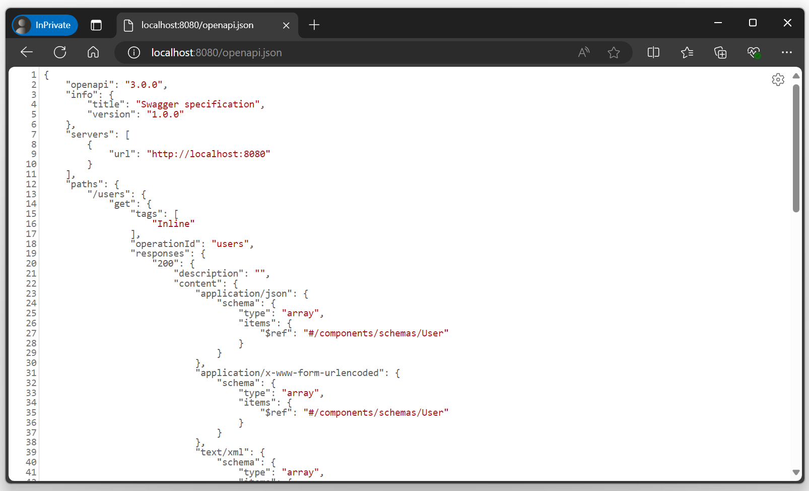
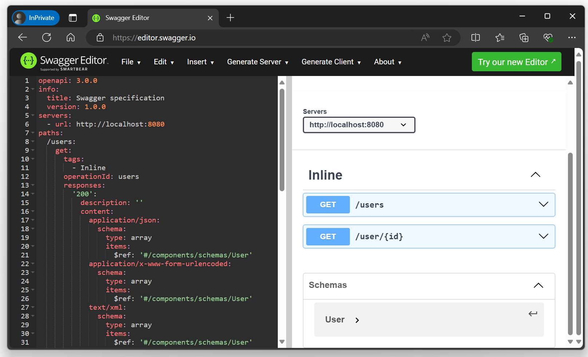

---
title: Open API
description: 'Dynamically generates an Open API v3 specification for a web service or controller'
cascade:
  type: docs
---





This concern dynamically generates and serves an [Open API v3 specification](https://github.com/OAI/OpenAPI-Specification) using 
[NSwag](https://github.com/RicoSuter/NSwag) for all detected API endpoints.




  ```csharp
  using GenHTTP.Engine.Internal;

  using GenHTTP.Modules.Layouting;
  using GenHTTP.Modules.OpenApi;
  using GenHTTP.Modules.Webservices;

  var api = Layout.Create()
                  .AddService<UserService>("users")
                  .AddOpenApi();

  await Host.Create()
            .Handler(api)
            .Development()
            .RunAsync();

  public record User(int ID, string Name);

  public class UserService
  {

      [ResourceMethod]
      public List<User> GetUsers() => [];

      [ResourceMethod(":id")]
      public User GetUser(int id) => new User(id, "John Doe");

  }
  ```



  ```csharp
  using GenHTTP.Engine.Internal;

  using GenHTTP.Modules.Functional;
  using GenHTTP.Modules.OpenApi;

  var api = Inline.Create()
                  .Get("/users", () => new List<User>())
                  .Get("/user/:id", (int id) => new User(id, "John Doe"))
                  .AddOpenApi();

  await Host.Create()
            .Handler(api)
            .Development()
            .RunAsync();

  record User(int ID, string Name);
  ```



  ```csharp
  using GenHTTP.Api.Protocol;
  using GenHTTP.Engine.Internal;

  using GenHTTP.Modules.Controllers;
  using GenHTTP.Modules.Layouting;
  using GenHTTP.Modules.OpenApi;

  var api = Layout.Create()
                  .AddController<UserController>("users")
                  .AddOpenApi();

  await Host.Create()
            .Handler(api)
            .Development()
            .RunAsync();

  public record User(int ID, string Name);

  public class UserController
  {

      [ControllerAction(Method.Get)]
      public List<User> List() => [];

      [ControllerAction(Method.Get)]
      public User Find([FromPath] int id) => new(id, "John Doe");

  }
  ```




This example provides a functional API with two operations and hosts a self-describing
Open API specification via http://localhost:8080/openapi.json.



You can import this specification into other tools such as [Postman](https://www.postman.com/)
or [Swagger Editor](https://editor.swagger.io/) to execute requests or generate client implementations.



## Endpoints

The Open API concern provides the following endpoints:

| Endpoint        | Description                                                                                   |
|-----------------|-----------------------------------------------------------------------------------------------|
| `/openapi.json` | Open API specification serialized to `application/json`.                                      |
| `/openapi.yaml` | Open API specification serialized to `application/yaml`.                                      |
| `/openapi.yml`  | Open API specification serialized to `application/yaml`.                                      |
| `/openapi`      | Serialized depending on the `Accept` header of the request, falls back to `application/json`. |

## Documentation

By default, the specification is derived from the signatures of the methods implementing the
operations. To add descriptions, additional responses or headers, you can annotate your services,
methods, parameters and models with the attributes provided by the `GenHTTP.Api.Content.Services`
namespace. As these attributes are part of the `GenHTTP.Api` package, projects that only contain
services or models do not need to reference the Open API module.




  ```csharp
  using GenHTTP.Api.Content.Services;
  using GenHTTP.Api.Protocol;

  using GenHTTP.Engine.Internal;

  using GenHTTP.Modules.Layouting;
  using GenHTTP.Modules.OpenApi;
  using GenHTTP.Modules.Reflection;
  using GenHTTP.Modules.Webservices;

  var api = Layout.Create()
                  .AddService<UserService>("users")
                  .AddOpenApi();

  await Host.Create()
            .Handler(api)
            .Development()
            .RunAsync();

  [Summary("A user of the application")]
  public record User([Summary("The unique identifier of the user")] int ID,
                     [Summary("The display name of the user")] string Name);

  public record Error(string Message);

  [Tag("Users")]
  [Summary("Manages the users of the application")]
  [Response(ResponseStatus.BadRequest, "The request could not be processed", Type = typeof(Error))]
  public class UserService
  {

      [ResourceMethod(":id")]
      [Summary("Fetches a single user")]
      [Response(ResponseStatus.NotFound, "There is no user with the given ID")]
      [return: Summary("The user with the given ID")]
      public User GetUser([Summary("The ID of the user to fetch")] int id) => new(id, "John Doe");

      [ResourceMethod(Method.Post)]
      [Summary("Creates a new user")]
      [Remarks("The ID of the user is assigned by the server.")]
      [Response(ResponseStatus.Created, "The newly created user")]
      public Result<User> CreateUser([Summary("The user to be created")] User user)
          => new Result<User>(user).Status(ResponseStatus.Created);

  }
  ```



  ```csharp
  using GenHTTP.Api.Content.Services;
  using GenHTTP.Api.Protocol;

  using GenHTTP.Engine.Internal;

  using GenHTTP.Modules.Functional;
  using GenHTTP.Modules.OpenApi;
  using GenHTTP.Modules.Reflection;

  var api = Inline.Create()
                  .Get("/users/:id",
                       [Summary("Fetches a single user")]
                       [Response(ResponseStatus.NotFound, "There is no user with the given ID")]
                       [return: Summary("The user with the given ID")]
                       ([Summary("The ID of the user to fetch")] int id) => new User(id, "John Doe"))
                  .Post("/users",
                        [Summary("Creates a new user")]
                        [Remarks("The ID of the user is assigned by the server.")]
                        [Response(ResponseStatus.Created, "The newly created user")]
                        ([Summary("The user to be created")] User user) => new Result<User>(user).Status(ResponseStatus.Created))
                  .AddOpenApi();

  await Host.Create()
            .Handler(api)
            .Development()
            .RunAsync();

  [Summary("A user of the application")]
  record User([Summary("The unique identifier of the user")] int ID,
              [Summary("The display name of the user")] string Name);
  ```



  ```csharp
  using GenHTTP.Api.Content.Services;
  using GenHTTP.Api.Protocol;

  using GenHTTP.Engine.Internal;

  using GenHTTP.Modules.Controllers;
  using GenHTTP.Modules.Layouting;
  using GenHTTP.Modules.OpenApi;
  using GenHTTP.Modules.Reflection;

  var api = Layout.Create()
                  .AddController<UserController>("users")
                  .AddOpenApi();

  await Host.Create()
            .Handler(api)
            .Development()
            .RunAsync();

  [Summary("A user of the application")]
  public record User([Summary("The unique identifier of the user")] int ID,
                     [Summary("The display name of the user")] string Name);

  public record Error(string Message);

  [Tag("Users")]
  [Summary("Manages the users of the application")]
  [Response(ResponseStatus.BadRequest, "The request could not be processed", Type = typeof(Error))]
  public class UserController
  {

      [ControllerAction(Method.Get)]
      [Summary("Fetches a single user")]
      [Response(ResponseStatus.NotFound, "There is no user with the given ID")]
      [return: Summary("The user with the given ID")]
      public User Find([FromPath] [Summary("The ID of the user to fetch")] int id) => new(id, "John Doe");

      [ControllerAction(Method.Post)]
      [Summary("Creates a new user")]
      [Remarks("The ID of the user is assigned by the server.")]
      [Response(ResponseStatus.Created, "The newly created user")]
      public Result<User> Create([Summary("The user to be created")] User user)
          => new Result<User>(user).Status(ResponseStatus.Created);

  }
  ```




The following attributes are available:

| Attribute          | Applies to                                                  | Description                                                                         |
|--------------------|-------------------------------------------------------------|-------------------------------------------------------------------------------------|
| `[Summary]`        | Services, methods, parameters, return values, models, properties | A short description of the annotated element.                                  |
| `[Remarks]`        | Services, methods, models, properties                       | A detailed explanation, which will be rendered as Markdown by most tools.           |
| `[Tag]`            | Services, methods                                           | The group the operations are listed under.                                          |
| `[RequestBody]`    | Methods                                                     | Describes the body expected by the operation.                                       |
| `[Response]`       | Services, methods                                           | Declares a response that may be generated by the operation.                         |
| `[RequestHeader]`  | Services, methods                                           | Declares a header that is read from the request.                                    |
| `[ResponseHeader]` | Services, methods                                           | Declares a header that is sent with the response.                                   |

Attributes placed on a service or controller class apply to all operations provided by this class.

### Operations and Models

On a method, `[Summary]` and `[Remarks]` set the summary and the description of the operation.
On a parameter, the summary describes the corresponding parameter of the operation (or the request body,
if the argument is read from the body). On the return value (`[return: Summary("...")]`), it describes
the successful response of the operation.

On model types and their properties, `[Summary]` and `[Remarks]` are added to the generated JSON
schema. For positional records, the attributes can be placed on the parameters of the record as
shown in the example above, so there is no need to target the generated property with `[property: Summary("...")]`.

Methods marked with the `[Obsolete]` attribute will be flagged as deprecated.

### Grouping

Operations are grouped by the name of the class they are declared in. Operations of
[functional handlers](../../frameworks/functional/) are grouped under `Inline`. Placing `[Tag]` on
a service class lists all of its operations under the given name, while summary and remarks of the
class are used to describe this group. Placing `[Tag]` on a method lists this operation under the
given name, regardless of the class it is declared in.

### Request Bodies

The request body is derived from the parameters of the method. If your method reads the
body on its own (e.g. from the request or a stream), or accepts specific content types only,
you can describe the body with the `[RequestBody]` attribute. Declaring multiple bodies with
different content types will merge them into a single request body. The attribute is ignored
for `GET` operations.

```csharp
[ResourceMethod(Method.Put, "avatar")]
[RequestBody("The new avatar of the user", ContentType = "image/png")]
[RequestBody(ContentType = "image/jpeg")]
public void SetAvatar(Stream content) { /* ... */ }

[ResourceMethod(Method.Post, "import")]
[RequestBody("The users to be imported", Type = typeof(List<User>))]
public async Task Import(IRequest request) { /* ... */ }
```

If only a description is given, the content types and the schema derived from the method signature
are kept.

### Responses

Responses are derived from the return type of the method. The `[Response]` attribute declares
additional responses, such as errors that may occur. If no description is given, it is derived
from the status (e.g. `Not Found`), and the content type is derived from the serialization formats
supported by the service, if a `Type` is given. Use `ContentType` to announce a specific format,
e.g. for methods that return a dynamically generated `IResponse`:

```csharp
[ResourceMethod("avatar")]
[Response(ResponseStatus.Ok, "The avatar of the user", ContentType = "image/png")]
[Response(ResponseStatus.Ok, ContentType = "image/jpeg")]
public IResponse GetAvatar(IRequest request) { /* ... */ }
```

The following rules apply:

- Declaring a successful response (2xx) on a method replaces the derived responses. This allows to announce
  that an operation responds with `201 Created` instead of `200 OK`. If no `Type` is given, the return type
  of the method is used to describe the content.
- Responses declared on a service class apply to all operations of this service that do not declare a response
  with the same status on their own. This allows to document common error responses in a single place.
- Declaring multiple responses with the same status but different content types will merge them into a
  single response.

### Headers

Headers read from the request or sent with the response can be declared with the `[RequestHeader]`
and `[ResponseHeader]` attributes. By default, headers are expected to be strings, which can be changed
by setting the `Type` property.

```csharp
[ResourceMethod]
[RequestHeader("X-Page", "The page to be returned", Type = typeof(int))]
[ResponseHeader("X-Total-Count", "The total number of users", Type = typeof(int))]
[Response(ResponseStatus.TooManyRequests, "Too many requests have been sent")]
[ResponseHeader(ResponseStatus.TooManyRequests, "Retry-After", "The number of seconds to wait", Type = typeof(int))]
public List<User> GetUsers(IRequest request) { /* ... */ }
```

A request header is optional unless `Required` is set to `true`. A response header without a
status is added to all successful responses (2xx) of the operation. If a status is given,
the header is only added if the operation declares a response with this status.

### Concerns

Concerns such as [range support](../range-support/) add functionality to the content they
wrap, e.g. by reading additional headers or generating additional responses. Concerns that
implement the `IDocumentedConcern` interface add this functionality to the generated specification.
The following concerns shipped with the framework document themselves:

| Concern                                                   | Documentation                                                                       |
|-----------------------------------------------------------|-------------------------------------------------------------------------------------|
| [Client Caching (Policy)](../client-caching-policy/)      | `Expires` header for successful `GET` responses                                     |
| [Client Caching (Validation)](../client-caching-validation/) | `If-None-Match` request header, `304 Not Modified` response and `ETag` headers   |
| [Decompression](../decompression/)                        | `Content-Encoding` request header for operations accepting a body                   |
| [Localization](../localization/)                          | `Content-Language` header for successful responses                                  |
| [Range Support](../range-support/)                        | `Range` request header, `206` and `416` responses with the corresponding headers    |

To document a custom concern, implement `IDocumentedConcern` instead of `IConcern`. The `AddDocumentation`
method is called for every operation provided by the wrapped content, with `Method` indicating the
HTTP verb of the operation. Concerns may add `[Response]`, `[RequestHeader]` and `[ResponseHeader]`
instances, other kinds of documentation are ignored.

```csharp
using GenHTTP.Api.Content;
using GenHTTP.Api.Content.Services;
using GenHTTP.Api.Infrastructure;
using GenHTTP.Api.Protocol;

public class RateLimitConcern : IDocumentedConcern
{

    public IHandler Content { get; }

    public RateLimitConcern(IHandler content)
    {
        Content = content;
    }

    public ValueTask PrepareAsync(IServer server) => Content.PrepareAsync(server);

    public ValueTask<IResponse?> HandleAsync(IRequest request)
    {
        // check the rate limit and respond with 429 if exceeded
        return Content.HandleAsync(request);
    }

    public void AddDocumentation(OperationDocumentation operation)
    {
        operation.Add(new ResponseAttribute(ResponseStatus.TooManyRequests, "Too many requests have been sent"))
                 .Add(new ResponseHeaderAttribute(ResponseStatus.TooManyRequests, "Retry-After", "The number of seconds to wait") { Type = typeof(int) });
    }

}
```

The documentation added by a concern is treated as if it was declared on the service class of
the operation. Documentation declared on the service itself and documentation added by concerns
closer to the content take precedence.

## Customizing

To customize the generated specification you can pass a function that will be executed
just before the document is serialized and sent to the requesting client.

```csharp
using GenHTTP.Engine.Internal;

using GenHTTP.Modules.Functional;
using GenHTTP.Modules.OpenApi;

var description = ApiDescription.Create()
                                .Title("My awesome API")
                                .Version("2.0.7")
                                .PostProcessor((r, doc) => doc.Info.TermsOfService = "https://mycompany.com/tos");

var api = Inline.Create()
                .Add(description);

await Host.Create()
          .Handler(api)
          .Development()
          .RunAsync();
```

## Caching

As automatically generating a specification is an expensive task, the concern will cache
the generated document for improved performance. In some cases you might want
the specification to be generated on every request, especially if the result depends on the
request sent by the client. In this case, you can disable caching, causing the
document to be generated on every request.

```csharp
var description = ApiDescription.Create()
                                .Caching(false);
```

## Visualizing Definitions

To explore your APIs using graphical applications such as Swagger or Redoc,
you can use the [API browsing](../../handlers/api-browsing/) functionality.

## Custom Discovery

By default, automatic discovery will handle [functional handlers](../../frameworks/functional/),
[webservices](../../frameworks/webservices/) and [controllers](../../frameworks/controllers/)
and will traverse automatically through [layouts](../../handlers/layouting/) and
[concerns](../). If you would like to support an additional handler, you can
initialize a registry and pass a custom `IApiExplorer`.

The following example adds support for redirects, so the generated Open API specification
will describe the operation.

```csharp
using GenHTTP.Api.Content;
using GenHTTP.Api.Protocol;

using GenHTTP.Engine.Internal;

using GenHTTP.Modules.Redirects;
using GenHTTP.Modules.Redirects.Provider;
using GenHTTP.Modules.Layouting;
using GenHTTP.Modules.OpenApi;
using GenHTTP.Modules.OpenApi.Discovery;

using NSwag;

var discovery = ApiDiscovery.Default()
                            .Add<RedirectExplorer>();

var description = ApiDescription.With(discovery);

var api = Layout.Create()
                .Add("google", Redirect.To("https://google.com"))
                .Add(description);

await Host.Create()
          .Handler(api)
          .Development()
          .RunAsync();

class RedirectExplorer : IApiExplorer
{

    public bool CanExplore(IHandler handler) => handler is RedirectProvider;

    public ValueTask ExploreAsync(IRequest request, IHandler handler, List<string> path, OpenApiDocument document,
                                 SchemaManager schemata, InheritedDocumentation documentation, ApiDiscoveryRegistry registry)
    {
        if (handler is RedirectProvider redirect)
        {
            var apiPath = OpenApiExtensions.BuildPath(string.Empty, path, false);

            var pathItem = new OpenApiPathItem();

            var operation = new OpenApiOperation();

            var response = new OpenApiResponse();

            response.Headers.Add("Location", new OpenApiHeader() { Default = redirect.Target });

            var status = redirect.Temporary ? "307" : "308";

            operation.Responses.Add(status, response);

            pathItem.Add("get", operation);

            document.Paths.Add(apiPath, pathItem);
        }

        return ValueTask.CompletedTask;
    }

}
```

Explorers for handlers that wrap other handlers should pass the given `documentation` on when
exploring their children via the `registry`, so that the documentation added by
[concerns](#concerns) further up in the chain is applied to the operations found.

If you would like to have an API explorer for a handler that is shipped with the framework,
feel free to get in touch via a GitHub issue or via Discord. 
